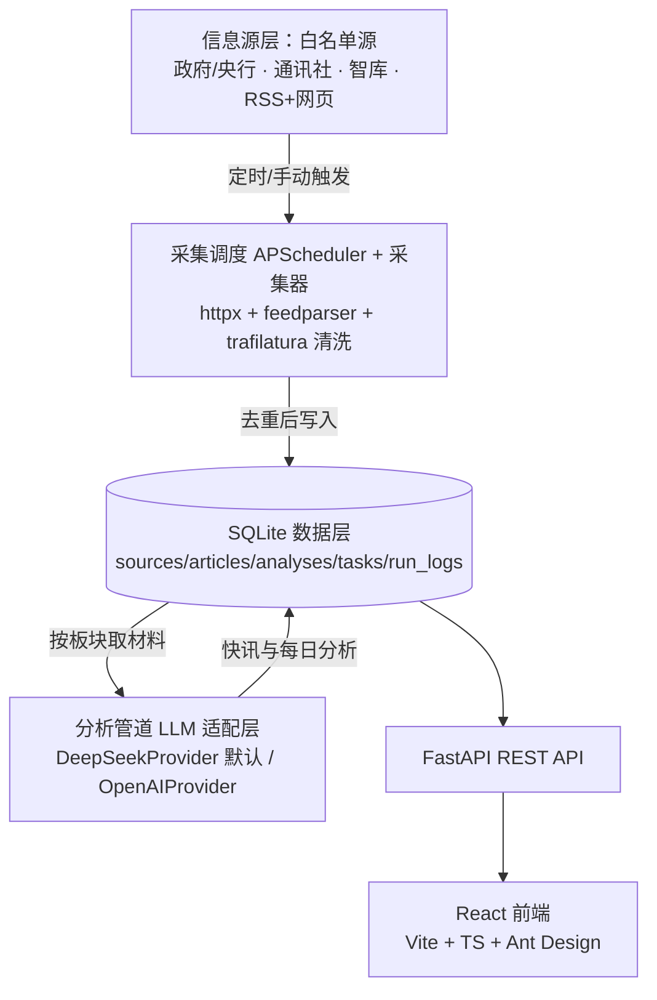

# Aurora 信息收集与分析系统 · 设计文档

- 日期：2026-09-07
- 状态：设计已获用户确认（brainstorming 完成）
- 下一步：转入 writing-plans 编写实施计划

## 1. 背景与目标

Aurora 是一个**个人单用户**使用的全球信息收集与分析工具。系统按**政治、经济、金融、军事**四大板块，从白名单权威信源定时采集全球信息，采集后由大模型生成两类中文产物：板块快讯要点与深度分析文章。

### 1.1 成功标准

- 默认每天 08:00 自动为四大板块各生成一篇中文分析文章（时段可配置）
- 默认每 4 小时自动采集一轮；也支持用户手动触发任意板块/任务的采集与分析
- 新增原文自动去重；分析文章中的每条引用都能追溯到具体原文
- 单源或单板块故障不影响整轮任务，运行日志可见、失败可一键重跑
- 前端五个页面（仪表盘、板块页、阅读页、源管理、任务管理）完整可用

## 2. 范围

### 2.1 已确认需求

- 单用户、本地/个人运行，无账号与权限体系
- 四大板块：政治 / 经济 / 金融 / 军事
- 信息源策略：**白名单权威源**，初始由系统内置精选（官方机构、顶级通讯社/媒体、智库与研究所），界面可增删改、启停、测试
- 输出语言：**中文**为主，原文引用可保留英文术语
- 分析用途：以“投资与研究参考”为主、兼带“板块简报”浏览
- 节奏：每 4~6 小时快讯 + 每天固定时间四板块深度分析；额外支持手动执行
- 模型：LLM 适配层可插拔，默认 DeepSeek
- 前端页面：仪表盘、板块页 ×4、文章阅读页、采集源管理、任务管理

### 2.2 明确不做（第一版）

- 多用户 / 账号 / 权限
- 邮件、IM（Telegram/微信）等推送通知
- 全网开放采集与关键词搜索（白名单之外不抓取）
- 向量库与全文语义检索
- 导出 PDF / 收藏体系 / 移动端 App / 多语言界面

## 3. 总体架构

采用**单进程单体仓库**（方案 A）：

选择理由：单用户每天数百条新闻的数据量下，SQLite + 单进程足够；开发与运维成本最低；模块按职责切分、接口清晰，未来可平滑拆出独立 worker。

### 3.1 模块划分

| 模块 | 职责 | 依赖 |
| --- | --- | --- |
| 采集调度（scheduler） | 从 tasks 表同步并注册 APScheduler 作业，防重入 | APScheduler、tasks 表 |
| 采集器（collectors） | RSS/网页抓取、正文提取、规范化、去重、入库、源健康更新 | httpx、feedparser、trafilatura |
| 分析管道（analysis） | 材料选择、提示词组装、LLM 调用、产物解析与引用落库 | LLM 适配层、articles 表 |
| 数据访问（repositories） | 全部 ORM 访问，业务层不直接碰 SQLAlchemy | SQLAlchemy |
| REST API | 前端所需的全部端点 | repositories + services |
| 前端 | 五个页面 + 状态轮询 + 操作入口 | React、Ant Design |

## 4. 技术选型

| 层 | 选型 |
| --- | --- |
| 后端语言/运行 | Python 3.12，包管理 uv |
| Web 框架 | FastAPI + uvicorn |
| ORM / 数据库 | SQLAlchemy 2 + SQLite（WAL 模式） |
| 调度 | APScheduler（后端进程内） |
| 抓取 | httpx、feedparser（RSS）、trafilatura（HTML 正文） |
| LLM 调用 | 自研轻量 Provider 协议，OpenAI 兼容 chat/completions 接口（DeepSeek 默认）；不引入 langchain |
| 后端测试 | pytest、TestClient、临时 SQLite、本地 fixture RSS |
| 前端 | React 18 + TypeScript + Vite + Ant Design 5 + react-router |
| 前端测试 | 类型检查 + 构建 + vitest 关键组件冒烟 |

## 5. 数据模型

固定板块枚举：`politics / economy / finance / military`。

### 5.1 sources · 采集源

`id, name, url, feed_type(rss|page), lang, enabled, last_ok_at, last_error, error_count, created_at`

### 5.2 source_categories · 源与板块多对多

`source_id, category`；一个源可属于多个板块（如 Reuters 可同时挂经济与金融）。

### 5.3 articles · 原文

`id, source_id(FK, nullable), category, url(UNIQUE), title, summary, content_text, published_at, fetched_at, dedupe_hash, lang`

- `url` 唯一约束兜底；`dedupe_hash` 为规范化 URL/标题的 SHA-256
- 删除源时保留其历史文章（`source_id` 置空，`ON DELETE SET NULL`），避免破坏分析与引用关联
- 正文长度上限 8000 字符，超出截断

### 5.4 analyses · 分析产物

`id, kind(brief|daily), category, title, content_md, period_start, period_end, model, status(pending|success|failed), error, created_at`

### 5.5 analysis_articles · 分析与引用原文关联

`analysis_id, article_id`；支撑“资料来源”的可追溯展示。

### 5.6 tasks · 定时任务

`id, name, kind(collect|analyze), category(nullable), cron, enabled, last_run_at, next_run_at, created_at`

### 5.7 run_logs · 运行日志

`id, task_id, started_at, finished_at, status(success|partial|failed), fetched_count, new_count, error`

### 5.8 kv_settings · 系统配置

`key, value`：默认模型、每日分析时刻、LLM Provider 等运行时配置。

## 6. 采集子系统

### 6.1 流水线

触发（定时/手动）→ 按源抓取更新 → 规范化与正文提取 → 去重 → 入库并更新源健康 → 触发后续分析（如配置）。

细节：

- RSS 条目提供 title/summary/link/published_at；新条目按需用 trafilatura 提取正文（单篇超时 15s，字符上限 8000）
- 单源超时 20s、失败重试 2 次（指数退避）；单源失败只记日志，整轮继续，run 标记 `partial`
- 单源每轮最多取最新 20 条，控制抓取体量
- 全局限并发 4，宿主间最小请求间隔保证礼貌抓取
- 跨源同事件**不在入库时合并**，原文全部保留供溯源；事件归并交给分析阶段的 LLM

### 6.2 去重

- URL 规范化：去 `utm_*`/跟踪参数、去尾斜杠、协议小写，取 SHA-256
- 同源标题规范化后相似（如“更新：”前缀）视为重复跳过
- `url` 唯一约束兜底，重复写入静默跳过

### 6.3 源健康与停用

- 每次成功记录 `last_ok_at`，失败累加 `error_count`
- 连续失败 3 次 → 自动停用（`enabled=false`）并在源管理页醒目提示；用户可一键“启用并测试”
- 状态展示：正常 / 慢响应 / 失败 N 次 / 已停用

## 7. 分析子系统

### 7.1 快讯要点（brief）

- 触发：每轮采集结束后，对新增原文大于 0 的板块执行
- 输入：该轮新增原文标题 + 摘要
- 输出：3~5 条中文要点，每条 = 事件一句话 + 影响提示 + 来源站点
- 存储为 `analyses(kind=brief)`，展示在板块页快讯时间线顶部

### 7.2 每日分析（daily）

- 触发：默认每天 08:00（配置项），也支持板块页/任务页手动触发
- 输入：该板块过去 24h 原文，按发布时间取最新 Top 30；单篇截断 6000 字符
- 输出：1500~2500 字中文分析，固定结构：
  1. 要点速览（3~5 条结论）
  2. 重大事件与事实（事件、主体、口径/数据、来源）
  3. 影响与传导分析（跨板块传导，如地缘→能源→通胀→利率→资产）
  4. 风险与关注信号（待跟踪指标与事件）
  5. 资料来源（按编号引用，可映射回原文）

### 7.3 LLM 适配层

- 协议：`ChatProvider`（async），方法 `complete(messages, temperature, max_tokens)`，超时 120s
- 实现：`DeepSeekProvider`（默认，`deepseek-chat`）、`OpenAIProvider`，均走 OpenAI 兼容接口
- 由 `.env` 与 kv_settings 决定 provider/model；保留 key 不在代码与前端出现
- 失败退避重试 2 次；仍失败则该板块产物标记 `failed` 并写入错误，可单独重跑

### 7.4 防幻觉与引用绑定

- 提示词规定：只能基于提供的编号材料，禁止编造来源与数据
- 要求模型在“资料来源”中以编号形式引用；解析后仅保留能对应真实 article_id 的编号，写入 `analysis_articles`
- 无法验证的引用在保存时剔除并记录，不展示

## 8. REST API

| 方法与路径 | 用途 |
| --- | --- |
| GET /api/health | 健康检查 |
| GET /api/dashboard/summary | 仪表盘统计（今日新增、今日分析、源健康、下次运行） |
| GET /api/categories | 板块列表与各板块最新动态 |
| GET /api/categories/{cat}/articles | 板块快讯流（分页） |
| GET /api/categories/{cat}/analyses | 板块分析列表 |
| GET /api/analyses/{id} | 分析正文 + 引用原文 |
| GET /api/articles/{id} | 原文详情 |
| GET/POST /api/sources | 源列表 / 新增源 |
| PATCH /api/sources/{id} | 编辑、启停源 |
| DELETE /api/sources/{id} | 删除源（历史文章保留，来源置空） |
| POST /api/sources/{id}/test | 抓取测试（真实抓一次，返回结果） |
| GET/POST /api/tasks | 任务列表 / 新增任务 |
| PATCH /api/tasks/{id} | 编辑、启停 |
| POST /api/tasks/{id}/run | 手动执行（记录日志） |
| GET /api/logs | 运行日志 |

## 9. 前端设计

路由：`/dashboard`、`/category/:cat`、`/analysis/:id`、`/article/:id`、`/sources`、`/tasks`。

### 9.1 全局

顶部导航：Aurora 标识、仪表盘、政治、经济、金融、军事、源管理、任务管理；右上角最后更新时间 + “手动采集”按钮。数据用轮询（仪表盘 30s），关键操作带 loading 与失败提示。

### 9.2 仪表盘

统计卡（今日新增原文 / 今日分析 / 采集源健康：正常数 ÷ 启用数 / 下次每日分析）+ 四板块卡片（最新分析 + 3 条快讯）+ 最近运行日志（含失败重跑入口）。

### 9.3 板块页

顶部：板块名、最近更新时间、“生成今日分析”“查看该板块来源”；内容区 = 最新分析文章卡片 + 快讯时间线（时间/来源/标题，点击进原文或分析）。

### 9.4 阅读页

面包屑 + 文章头（标题、生成时间、模型、引用数）；正文按五段结构渲染 Markdown；右侧栏“资料来源”（站点 + 标题 + 原文链接）与“相关分析”。

### 9.5 源管理

筛选/搜索工具栏 + 表格（名称 URL、板块标签、类型、语言、健康、启用开关、测试/编辑）；新增/编辑用弹窗，字段含名称、URL、类型、板块多选、语言，保存后可立即测试。

### 9.6 任务管理

任务卡片列表（名称、kind、cron、启用开关、上次/下次运行、立即执行、日志）；日志抽屉展示 run_logs，失败行可一键重跑。

## 10. 调度与运行模型

内置种子任务：

| 任务 | kind | cron |
| --- | --- | --- |
| 采集 · 全板块 | collect | `0 */4 * * *` |
| 每日分析 · 四板块 | analyze | `0 8 * * *` |

用户可新增自定义任务（如“军事 · 每 6 小时”）。

- 后端启动时从 tasks 表同步注册 APScheduler 作业，进程内每分钟校验一次配置变化
- 采集与分析任务串行执行（进程内锁），避免 SQLite 写锁竞争与资源重叠
- 手动执行与定时执行共用同一入口，均写 run_logs
- 第一版不做停机补跑；错过时段可手动触发

## 11. 错误处理与可观测性

- 采集：单源隔离、重试、`partial` 状态、健康计数与自动停用
- 分析：LLM 退避重试、单板块失败独立重跑、引用不可验证时剔除
- API：统一异常处理器，错误消息中文返回，前端 toast 展示
- 日志：run_logs 全覆盖（起止、状态、数量、错误），失败原因进抽屉
- 数据库：SQLite WAL、短事务、唯一约束兜底；启动时建表 + 种子

## 12. 测试策略

后端（pytest）：

- 单元：URL/标题规范化与去重、正文清洗、cron 解析、源健康状态机
- Provider：用假 LLM 返回固定 Markdown，验证分析与引用落库
- API：TestClient + 临时 SQLite，覆盖源 CRUD、手动执行、列表与详情
- 集成：本地 fixture RSS 文件 + mock 传输，验证“采集→去重→入库→快讯生成”链路

前端：

- `tsc` 类型检查与生产构建通过
- vitest：关键组件冒烟（新增源表单、任务立即执行、日志抽屉）

## 13. 配置与安全

`.env.example` 提供：`LLM_PROVIDER`、`DEEPSEEK_API_KEY`、`LLM_BASE_URL`、`LLM_MODEL`、`DB_PATH`、`COLLECT_INTERVAL_HOURS`、`DAILY_ANALYSIS_HHMM`。API Key 只存后端环境变量，`.env` 不入库不入 git。前端不接触 Key。

## 14. 迭代里程碑

- **M1 后端骨架**：仓库与前后端脚手架、数据模型、内置源种子、配置
- **M2 采集管道**：RSS/网页抓取、清洗、去重、源健康、手动执行 API
- **M3 分析与文章**：LLM 适配层、快讯与每日分析管道、引用落库
- **M4 前端五页**：仪表盘、板块页、阅读页、源管理、任务管理
- **M5 调度与打磨**：APScheduler 全量接入、默认任务、错误恢复、测试与 README

## 15. 风险与应对

- **源结构变化/被墙**：提供“测试抓取”与健康停用机制；内置源可随时编辑替换
- **LLM 成本与超时**：材料 Top-30 + 截断 + 退避重试；成本可在任务页观察新增/失败量
- **引用幻觉**：编号引用 + 落库校验，剔除非真实引用
- **SQLite 并发写**：任务串行 + WAL；若未来数据量激增再迁移 Postgres（repositories 层隔离可平滑切换）
